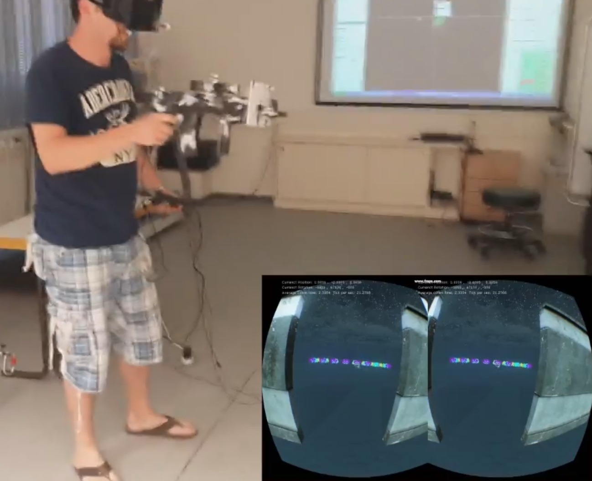

# RiftFusion: positional tracking for Oculus Rift

<p align="center">
  
</p>

*Original project image, unchanged.*

RiftFusion investigated adding positional tracking to the Oculus Rift using either KinectFusion or a Vicon system. The design separated tracking providers, a position server and a consumer application.

Students: [Dor Goldbaum](https://www.linkedin.com/in/dorgold/), [Vlady Ostrovski](https://www.linkedin.com/in/vladislav-ostrovski-b99619121/). Supervision: Aaron Wetzler.


## Original

The original image, a 13-slide presentation and the historical video link are preserved. No source code, tracking data, executable or build configuration has been recovered. The [recovery notes](docs/RECOVERY.md) record historical requirements and attribution; [PROVENANCE.md](PROVENANCE.md) records provenance and the scope of the authors' responses.

## Updated

[**Run the browser demo**](https://twerdster.github.io/oculus-positional-tracking/)

A separate browser demo, written in November 2026, plays a generated head trajectory. You can vary synthetic noise, sample delay and exponential smoothing, compare the known path with the filtered estimate, and export the samples. It uses no KinectFusion or Vicon recordings and runs none of the original code. Noise and delay are illustrative settings, not measured sensor performance. The recovered original files are unchanged.

### Run locally

```sh
python3 -m http.server 8000 --directory docs
```

Then open http://localhost:8000. No build step or external service is required.

### Checks and licensing

Browser-check results, implementation notes and limits are in [updated/README.md](updated/README.md). These checks apply only to the new demo; they do not validate the historical system or any hardware. The [MIT license](docs/DEMO-LICENSE.txt) covers only the new demo; original materials keep their existing attribution and terms.
